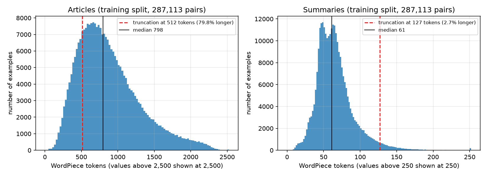
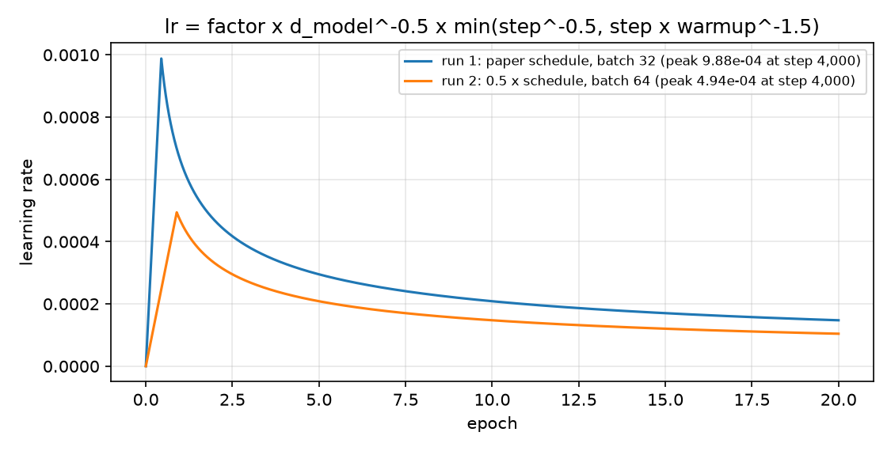
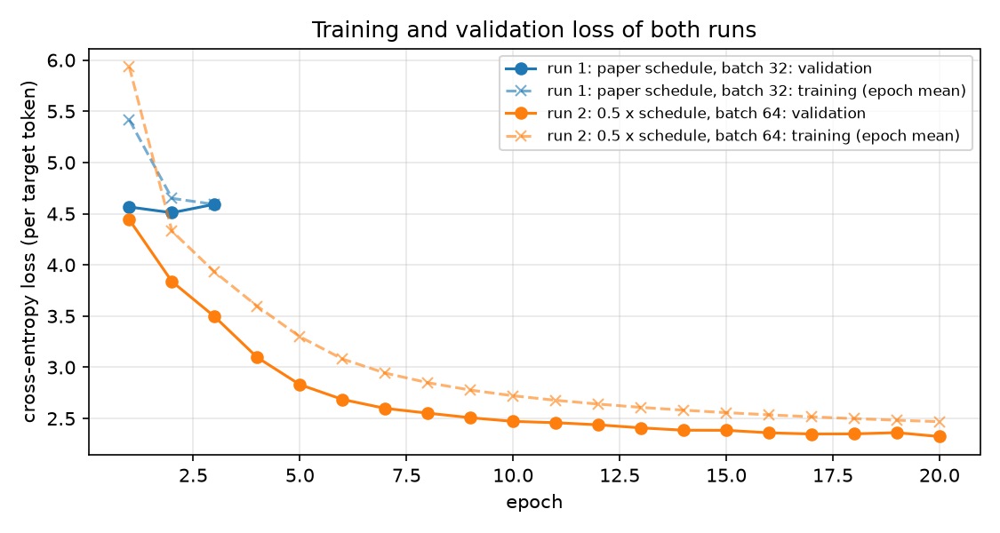
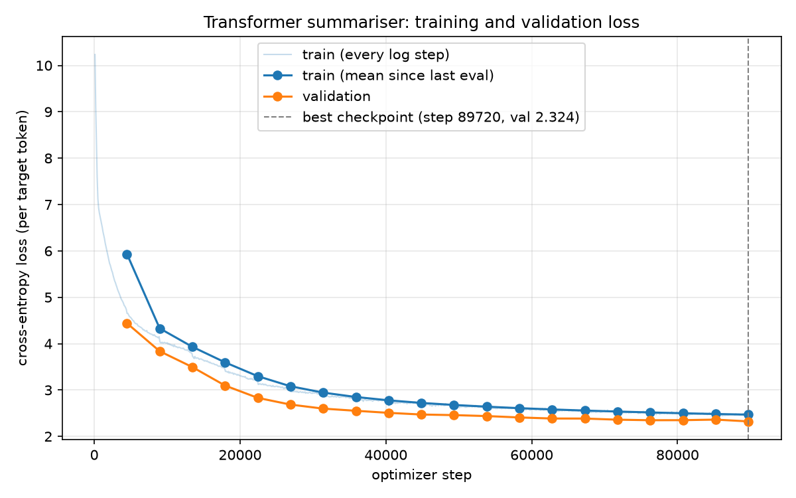
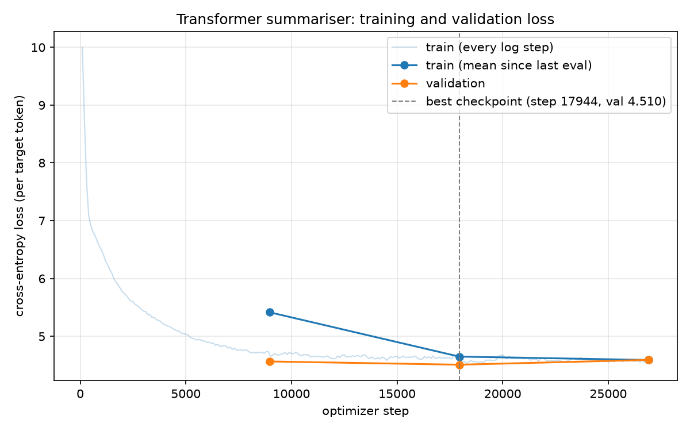
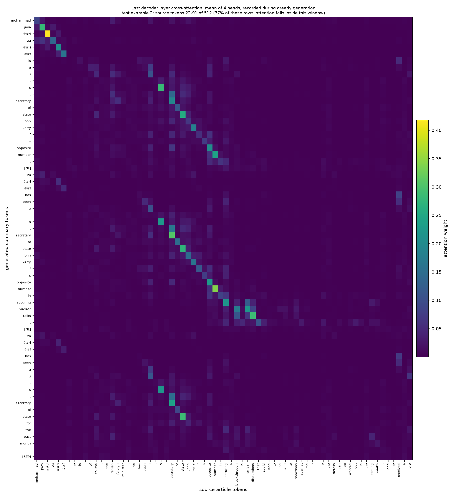
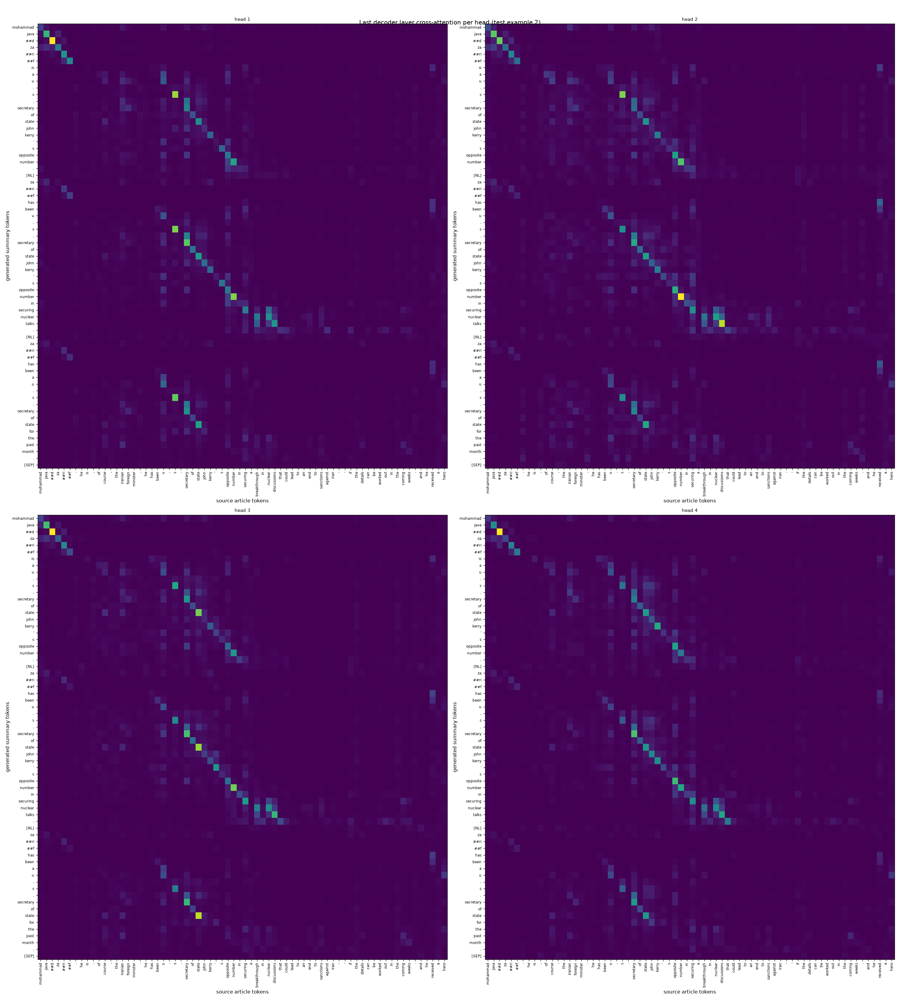
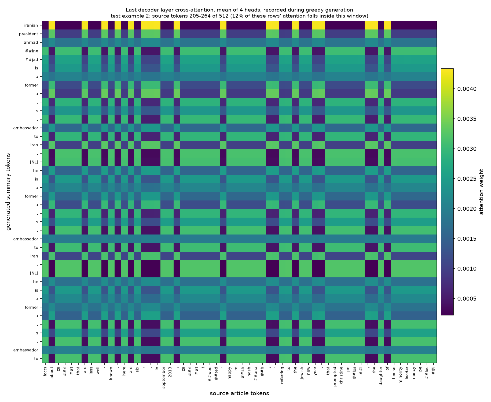

# Abstractive Text Summarization with a Transformer Built from Scratch

**DSL 504 Natural Language Processing: Group Assignment 2, Question 3**

**Group members:** ⟦PENDING: names and roll numbers⟧

---

## Abstract

We implement the Transformer encoder-decoder of Vaswani et al. (2017) from basic PyTorch layers and
train it to write multi-sentence summaries of news articles from the CNN / Daily Mail dataset. The
attention, feed-forward, positional-encoding, encoder-layer and decoder-layer code is our own; only
the tokenizer is pre-trained. The model has 15.2 million parameters (d_model 256, 4 heads, 4 encoder
and 4 decoder layers) and is trained on all 287,113 training pairs with teacher forcing, the paper's
warm-up learning-rate schedule and early stopping on the validation loss. Summaries are generated
with greedy decoding and scored with ROUGE on the full test set of 11,490 articles. A first run with
the paper's exact learning rate stalled (validation loss 4.51, ROUGE-1 13.65); with half the learning
rate and twice the batch size, the final model reaches a validation loss of 2.32 and ROUGE-1 36.72,
ROUGE-2 15.32, ROUGE-L 25.67 and ROUGE-Lsum 34.33. This is 3.3, 2.2 and 2.0 points below the Lead-3
baseline on ROUGE-1, ROUGE-2 and ROUGE-Lsum, and 0.65 points above it on ROUGE-L. The model has
learned to copy from the article through attention, and its cross-attention forms clear alignments
between summary and article words. Its main weaknesses are repetition and phrases that are copied
correctly but attached to the wrong person or thing.

### Key facts at a glance

| Item | Value |
|---|---|
| Tokenizer | Pre-trained `bert-base-uncased` WordPiece, 30,522 sub-words + 1 added `[NL]` token = 30,523, shared by articles and summaries |
| Truncation | Articles: first 512 tokens. Summaries: first 127 tokens, plus a start or end token (128 decoder positions) |
| Model | d_model 256, 4 heads (d_k 64), 4 encoder + 4 decoder layers, d_ff 1024, dropout 0.1, tied embeddings |
| Parameters | 15,186,688 |
| Training-set size | 287,113 pairs (the full training split) |
| Training runs | Run 1: the paper's learning-rate schedule, batch 32 (stalled). Run 2: half the learning rate, batch 64 (32 x 2 accumulation steps). The final model is chosen by validation loss: run 2, epoch 20 (validation loss 2.324, perplexity 10.2) |
| Decoding | Greedy, at most 128 tokens, no teacher forcing |
| ROUGE on the test set (F1, 11,490 articles) | **ROUGE-1 36.72 / ROUGE-2 15.32 / ROUGE-L 25.67 / ROUGE-Lsum 34.33** (Lead-3: 40.06 / 17.48 / 25.02 / 36.36; Table 7) |

---

## 1. Introduction

Abstractive summarisation means writing a summary in new words, rather than copying sentences out
of the article (extractive summarisation). It is a sequence-to-sequence problem: the input is a news
article of several hundred words and the output is a short summary of three or four sentences.

We use the Transformer encoder-decoder from "Attention Is All You Need" (Vaswani et al., 2017). The
encoder reads the whole article and builds a contextual representation of every token. The decoder
writes the summary one token at a time; at every step it looks back at the summary written so far
(masked self-attention) and at the article (encoder-decoder attention). We implement every
component ourselves, train the model on CNN / Daily Mail, evaluate it with ROUGE, compare it with
the Lead-3 baseline, study its outputs and visualise where it attends while it writes.

## 2. Dataset and preprocessing

### 2.1 Dataset

We use CNN / Daily Mail version 3.0.0 (Hermann et al., 2015; Nallapati et al., 2016). Each example is
a news article and its "highlights", three or four sentences written by the journalists, separated by
newline characters. The highlights are the reference summaries.

**Table 1. Dataset splits and how we use them.**

| Split | Pairs | Used for |
|---|---|---|
| Training | 287,113 | Training the model (all of it) |
| Validation | 13,368 | Validation loss after every epoch, early stopping, choosing the checkpoint |
| Test | 11,490 | Final ROUGE scores only, never for training or tuning |

The dataset is loaded with `load_dataset("abisee/cnn_dailymail", "3.0.0")`. This is the same dataset
as the assignment's `load_dataset("cnn_dailymail", "3.0.0")`; recent versions of the Hugging Face
hub only accept the namespaced name. No split contains an empty article or summary, so no example
was dropped and the test set is complete.

### 2.2 Preprocessing pipeline

Preprocessing is done once by `prepare_data.py` (using `data.py`), and the result is cached as NumPy
arrays.

1. **Lowercasing and whitespace.** All text is lowercased and every run of whitespace is collapsed
   to a single space. Lowercasing matches the uncased tokenizer.
2. **Sentence separator.** The `\n` between highlight sentences is replaced by a special `[NL]` token.
   The BERT tokenizer treats a newline as ordinary whitespace, so without this the sentence
   boundaries would be lost. ROUGE-Lsum needs them: it compares the summaries sentence by sentence,
   with sentences separated by `\n` in both the reference and the output. The model learns to
   produce `[NL]` between sentences, and when token ids are turned back into text every `[NL]`
   becomes `\n` again.
3. **Sub-word tokenization.** We use the pre-trained `bert-base-uncased` WordPiece tokenizer
   (Devlin et al., 2019), which the assignment allows. Its vocabulary of 30,522 sub-words is extended
   with `[NL]` (id 30,522), giving 30,523 entries. Articles and summaries share this one vocabulary.
   Sub-words mean there are no out-of-vocabulary words: a rare word or name is split into known
   pieces, for example "123rd" becomes `123 ##rd`.
4. **Truncation.** Each article is cut to its first 512 tokens and each summary to its first 127
   tokens (Section 2.3).
5. **Start and end tokens.** Every summary gets the start token `[CLS]` (id 101) in front and the end
   token `[SEP]` (id 102) at the end. We reuse these existing special tokens instead of adding new
   ones.
6. **Padding.** Sequences are padded with `[PAD]` (id 0) to a fixed length (512 for articles, 129
   for summaries) and stored as `uint16` arrays. When a batch is built, the columns that are padding
   in every row of the batch are removed, so all sequences in a batch have the same length but no
   compute is wasted on padding beyond the longest sequence in the batch.

**Decoder input and target.** The summary `[CLS] w1 ... wn [SEP]` gives the decoder input (shifted
right, starts with the start token) and the prediction target (shifted left, ends with the end
token). Table 2 shows this for the first test example, whose summary has 40 tokens including the
start and end tokens.

**Table 2. Decoder input and target for test example 0.**

| Position | 1 | 2 | 3 | 4 | ... | 17 | 18 | ... | 39 |
|---|---|---|---|---|---|---|---|---|---|
| Decoder input | `[CLS]` | membership | gives | the | ... | . | `[NL]` | ... | last word |
| Target | membership | gives | the | icc | ... | `[NL]` | israel | ... | `[SEP]` |

The article of the same example begins
`( cnn ) the palestinian authority officially became the 123 ##rd member of the international criminal court on wednesday , ...`.

### 2.3 Length statistics and the truncation limits

**Table 3. Length in WordPiece tokens after lowercasing (summary lengths include the `[NL]` tokens).**

| Split | Article median | Article 90th pct | Article max | Articles > 512 | Summary median | Summary 90th pct | Summaries > 127 |
|---|---|---|---|---|---|---|---|
| Train | 798 | 1,479 | 6,321 | 79.8% | 61 | 97 | 2.7% |
| Validation | 763 | 1,474 | 2,415 | 75.7% | 67 | 109 | 4.4% |
| Test | 778 | 1,502 | 2,965 | 76.6% | 64 | 102 | 3.4% |



**Figure 1.** Article and summary lengths in the training split, with the truncation limits.

The assignment's table was measured on 2,000 test articles. On the first 2,000 test articles we get
an article median of 639 tokens, a 90th percentile of 1,301, a maximum of 2,965, 62% longer than 512
tokens, and a summary median of 49 (47 without `[NL]`). The assignment reports 641, 1,304, 2,967,
62.5% and 49, so our tokenization matches. The full test split has longer articles (median 778)
than this sample, so Table 3 gives the statistics of every full split.

**Why 512 article tokens.** About 77-80% of the articles are longer than 512 tokens, so most are
truncated. This loses little, because news articles put the key facts first (the "inverted pyramid"
style). We measured it on the test set: 86.3% of the distinct words of a reference summary appear
somewhere in the full article, and 80.8% already appear in its first 512 tokens. So the truncated
article still contains about 94% of the reference words that the article contains at all. 512 tokens
keep a median of 437 words per article. A longer limit would also be expensive: self-attention cost
grows with the square of the length, and 512 is the upper end of the range the assignment suggests.

**Why 127 summary tokens.** Only 2.7% of the training summaries are longer than 127 tokens, so almost
every summary is kept whole. With the start or end token this gives 128 decoder positions, which
matches the maximum generation length.

## 3. Model architecture

All model code is in `model.py`. It uses only `nn.Linear`, `nn.Embedding`, `nn.LayerNorm`,
`nn.Dropout` and plain tensor operations. No `nn.Transformer`, `nn.TransformerEncoder(Layer)`,
`nn.TransformerDecoder(Layer)`, `nn.MultiheadAttention`, `F.scaled_dot_product_attention`, Hugging
Face model class or pre-trained weight is used.

### 3.1 Overview

```
article ids (B, S)
  -> Embedding x sqrt(d_model) + positional encoding -> dropout
  -> 4 x EncoderLayer [ self-attention -> feed-forward ]
  -> memory (B, S, 256) ------------------------------------------+
                                                                  |
summary shifted right (B, T)                                      |
  -> Embedding x sqrt(d_model) + positional encoding -> dropout   |
  -> 4 x DecoderLayer [ masked self-attention                     |
                        -> encoder-decoder attention  <-----------+
                        -> feed-forward ]
  -> Linear (weights tied to the embedding) -> logits (B, T, 30,523)
```

B is the batch size, S the article length and T the summary length. The encoder and decoder share one
embedding table, because articles and summaries share one vocabulary.

### 3.2 Scaled dot-product attention and multi-head attention

The core formula is

```
Attention(Q, K, V) = softmax( Q K^T / sqrt(d_k) + mask ) V
```

`MultiHeadAttention` projects the queries, keys and values with three `nn.Linear(256, 256)` layers,
splits each into 4 heads of size d_k = 64, applies the formula to every head in parallel,
concatenates the heads and applies an output projection `nn.Linear(256, 256)`. The central lines:

```python
q = self._split_heads(self.w_q(query))                  # (B, H, Tq, Dk)
k = self._split_heads(self.w_k(key_value))              # (B, H, Tk, Dk)
v = self._split_heads(self.w_v(key_value))
scores = q @ k.transpose(-2, -1) / math.sqrt(self.d_k)  # (B, H, Tq, Tk)
scores = scores.masked_fill(~mask, torch.finfo(scores.dtype).min)
weights = torch.softmax(scores, dim=-1)                 # each row sums to 1
out = self.attn_dropout(weights) @ v                    # (B, H, Tq, Dk)
out = out.transpose(1, 2).contiguous().view(B, Tq, H * Dk)
return self.w_o(out), weights
```

Masking replaces a blocked score with the most negative finite number, which after the softmax
gives a weight of exactly zero, the same as adding minus infinity. A finite value is used so that a
row in which every position is blocked would give a uniform row instead of NaN. The same module
serves as self-attention (query and key_value are the same sequence) and as encoder-decoder
attention (the query comes from the decoder, key_value is the encoder output). It also returns the
attention weights, which we use for the visualisation in Section 7.

### 3.3 Position-wise feed-forward network

```
FFN(x) = max(0, x W1 + b1) W2 + b2
```

Two linear layers, 256 -> 1024 -> 256, with a ReLU in between (and dropout after the ReLU), applied
to every position separately.

### 3.4 Positional encoding

Attention by itself ignores word order, so a fixed sinusoidal encoding is added to the token
embeddings:

```
PE(pos, 2i)   = sin( pos / 10000^(2i / d_model) )
PE(pos, 2i+1) = cos( pos / 10000^(2i / d_model) )
```

The table is computed once for 512 positions and stored as a buffer, so it is not trained. As in the
paper, the embeddings are multiplied by sqrt(d_model) = 16 before the encoding is added, and dropout
is applied to the sum.

### 3.5 Encoder and decoder layers

Every sub-layer is wrapped as `LayerNorm(x + Dropout(Sublayer(x)))`, the post-norm form of the
original paper.

- **Encoder layer:** multi-head self-attention, then the feed-forward network.
- **Decoder layer:** masked multi-head self-attention over the summary so far, then encoder-decoder
  attention (queries from the decoder, keys and values from the encoder output), then the
  feed-forward network.

The model stacks 4 encoder layers and 4 decoder layers. Dropout (0.1) is applied to the embeddings,
to every sub-layer output, to the attention weights and inside the feed-forward network.

### 3.6 The three masks

Masks are boolean tensors in which True means "may attend".

**Table 4. Masks.**

| Mask | Shape | Used in | Blocks |
|---|---|---|---|
| Source padding mask | (B, 1, 1, S) | Encoder self-attention and encoder-decoder attention | Padding tokens of the article |
| Causal (look-ahead) mask | (1, 1, T, T) | Decoder self-attention | Later summary positions |
| Target padding mask | (B, 1, 1, T) | Decoder self-attention (combined with the causal mask by AND) | Padding tokens of the summary |

The causal mask is lower-triangular: position t may attend to positions 1 to t only. For T = 4:

```
1 0 0 0
1 1 0 0
1 1 1 0
1 1 1 1
```

### 3.7 Output layer and initialisation

A final linear layer maps each decoder output vector to 30,523 vocabulary logits. Its weight matrix
is shared with the embedding table (weight tying; Press and Wolf, 2017, also used in the Transformer
paper), which saves 7.8 million parameters. Weight matrices are initialised with Xavier-uniform
initialisation. The embedding table is initialised from a normal distribution with standard
deviation d_model^-0.5, so that after scaling by sqrt(d_model) the embeddings have roughly unit
variance, and the row of the padding token is set to zero.

### 3.8 Configuration and parameter count

**Table 5. Model configuration, compared with the paper's base model.**

| Hyperparameter | Ours | Transformer base (paper) |
|---|---|---|
| d_model | 256 | 512 |
| Attention heads (d_k) | 4 (64) | 8 (64) |
| Encoder / decoder layers | 4 / 4 | 6 / 6 |
| Feed-forward size d_ff | 1,024 | 2,048 |
| Dropout | 0.1 | 0.1 |
| Vocabulary | 30,523 (shared) | 37,000 (shared BPE) |
| Parameters | **15,186,688** | about 65 million |

Parameter breakdown:

| Part | Parameters |
|---|---|
| Shared embedding / output projection (30,523 x 256) | 7,813,888 (51.5%) |
| Encoder: 4 layers x 789,760 (attention 263,168 + feed-forward 525,568 + 2 LayerNorms 1,024) | 3,159,040 |
| Decoder: 4 layers x 1,053,440 (2 attentions 526,336 + feed-forward 525,568 + 3 LayerNorms 1,536) | 4,213,760 |
| **Total** | **15,186,688** |

Half of the parameters are in the embedding table, which is typical for a small model with a large
vocabulary. The configuration is within the range the assignment suggests (d_model 256-512, 3-6
layers per stack, 4-8 heads) and fits comfortably on an 8 GB GPU.

### 3.9 Greedy decoding

At test time there is no teacher forcing. `greedy_decode` encodes the article once and reuses the
encoder output at every step. It starts from `[CLS]`, runs the decoder on the tokens generated so
far, takes the most probable next token, appends it and repeats, until every summary in the batch
has produced `[SEP]` or 128 tokens have been generated. The padding and start tokens are never
chosen, and a sequence that has finished just receives padding while the rest of the batch
continues. With `return_attention=True`, the function also records the encoder-decoder attention of
the last decoder layer at every step, which is what Section 7 visualises. For simplicity the
decoder is re-run on the whole prefix at every step (no key/value cache); this is slower but gives
the same result.

### 3.10 Checking the implementation

`sanity_checks.py` tests the implementation before any real training:

| Check | Result |
|---|---|
| The model contains no built-in Transformer or attention modules | Passed |
| Causal mask: changing a later summary token never changes the output at earlier positions | Passed |
| Padding masks: adding padding to the article or the summary does not change the outputs | Passed |
| Attention weights sum to 1 and padding positions get zero attention | Passed |
| Copy task: a small model is trained to copy random sequences, then greedy decoding must reproduce them | 96% copied exactly (loss 0.005) |

The copy task exercises the whole pipeline end to end (embeddings, positional encoding, both attention
types, the masks, training and greedy decoding). A model with a broken causal mask or broken
cross-attention cannot pass it. The first two checks test directly for common pitfalls 2 and 3 of the
assignment.

## 4. Training

### 4.1 Setup

**Table 6. Training configuration.**

| Setting | Value |
|---|---|
| Training data | All 287,113 training pairs, reshuffled every epoch |
| Loss | Cross-entropy over the vocabulary, padding positions ignored (`ignore_index = 0`) |
| Teacher forcing | Decoder input = gold summary shifted right; the whole summary is trained in one parallel pass |
| Optimiser | Adam, beta = (0.9, 0.98), eps = 1e-9 |
| Learning-rate schedule | lr = factor x d_model^-0.5 x min(step^-0.5, step x warmup^-1.5), warm-up 4,000 steps; factor 1.0 in run 1 (the paper's schedule, peak 9.88e-4) and 0.5 in run 2 (peak 4.94e-4) |
| Batch size | Run 1: 32 articles (8,972 optimizer steps per epoch). Run 2: 64 articles, as 2 accumulated batches of 32 (4,486 steps per epoch) |
| Gradient clipping | Global norm 1.0 |
| Precision | bf16 mixed precision (the loss is computed in fp32) |
| Validation | Loss on all 13,368 validation pairs after every epoch |
| Early stopping | Stop after 3 epochs without improvement; at most 20 epochs |
| Checkpoint for testing | The best validation-loss checkpoint (`best.pt`), never the last one |
| Seed | 42 |
| Hardware | NVIDIA GeForce RTX 4060 Laptop GPU (8 GB), PyTorch 2.14.1 + CUDA 13.0 |
| Speed | About 12,000-13,000 target tokens per second, about 26 minutes per epoch including validation (run 2: 522 minutes for 20 epochs) |

**Teacher forcing.** During training the decoder input is the gold summary shifted right, so the model
predicts every summary token in one parallel pass. The causal mask makes sure that position t only
sees the gold tokens before it, so the model cannot copy the answer.

**Loss.** The cross-entropy is averaged over the real target tokens only; padding positions are
ignored in both the training and the validation loss (common pitfall 4). The validation loss is the
average over all non-padding target tokens of the validation split.

**Learning-rate schedule.** The learning rate rises linearly for the first 4,000 optimizer steps and
then decays in proportion to 1/sqrt(step). With the paper's schedule (run 1) the peak is 9.88e-4,
falling to 6.6e-4 at the end of epoch 1 and 4.7e-4 at the end of epoch 2. Run 2 multiplies the
schedule by 0.5 (peak 4.94e-4). Because run 2 accumulates two batches per optimizer step, its warm-up
lasts almost a whole epoch. The warm-up keeps the early updates small while Adam's statistics are
still unreliable, which matters for post-norm Transformers.



**Figure 2.** The learning-rate schedules of the two training runs, plotted against epochs.

**Early stopping.** After every epoch the model is evaluated on the validation split. When the
validation loss improves, the model is saved as `best.pt`. Training stops after 3 epochs in a row
without improvement, and the evaluation script always loads `best.pt` (common pitfall 7).

### 4.2 Two training runs

We trained the model twice. The assignment allows the validation split to be used for choosing
hyperparameters, and every decision below is based on the validation split only.

**Run 1: the paper's schedule, batch 32 (`runs/base`).**

| Epoch | Training loss (epoch mean) | Validation loss | Validation perplexity |
|---|---|---|---|
| 1 | 5.416 | 4.566 | 96.1 |
| 2 | 4.650 | **4.510** | **90.9** (best) |
| 3 | 4.591 | 4.592 | 98.7 |

The training loss stopped falling at about 4.6 after roughly 10,000 steps (1.1 epochs) and stayed
there for the next 1.5 epochs, and the validation loss rose in epoch 3. A 15-million-parameter model
trained on 287,113 articles should keep improving for much longer, so we examined the epoch-2
checkpoint on validation articles:

- **It uses the article only weakly.** On 128 validation pairs, its loss is 4.58 with the correct
  article and 5.15 when each summary is paired with a different article. So the article tells the
  model the topic, but little more.
- **Its cross-attention is almost uniform.** On 5 validation articles, the entropy of the last
  decoder layer's cross-attention is 94% of the entropy of a uniform distribution, and the largest
  attention weight is on average only 1.5 times the uniform weight (1/512). The decoder averages the
  whole article instead of looking at particular words.
- **The encoder has not collapsed.** The mean cosine similarity between the encoder's output
  vectors at different positions is about 0.7, so the positions are still distinguishable; the
  decoder simply has not learned to use them.
- **The summaries are generic and repetitive**, for example "the doctor is now in a hospital"
  repeated three times for an article about a kidney donation chain.

In short, run 1 learned a *topic-conditioned language model* of summaries: it writes fluent-looking
text about the right subject but cannot copy names, numbers or facts from the article. We attribute
this to a learning rate that is too high for our batch size. The paper's schedule was designed for
batches of about 25,000 tokens, while our batches of 32 summaries contain only about 2,000 target
tokens, so the gradient is much noisier. With noisy, large updates, a post-norm Transformer can get
stuck on the easy solution (predicting likely summary words from the topic) and never learn the
sharp encoder-decoder alignments needed for copying.

Because the validation loss had risen and the training loss had been flat for 1.5 epochs, we stopped
run 1 by hand after epoch 3 instead of waiting two more epochs for early stopping, and kept its best
checkpoint (epoch 2) as a fallback.

**Run 2: half the learning rate, batch 64 (`runs/lr05_b64`).** We changed only two settings: the
learning-rate factor from 1.0 to 0.5, and the batch size from 32 to 64 (two accumulated batches of
32, because of GPU memory). Everything else, including the model, the data and the seed, is the same.

Run 2 trained for the full 20 epochs (89,720 optimizer steps, 8.7 hours). Early stopping never
triggered: the validation loss did not improve in epochs 18 and 19 (2 of the 3 allowed epochs) but
reached its lowest value in epoch 20.

| Epoch | Training loss (epoch mean) | Validation loss | Validation perplexity |
|---|---|---|---|
| 1 | 5.934 | 4.441 | 84.9 |
| 2 | 4.330 | 3.837 | 46.4 |
| 3 | 3.931 | 3.495 | 32.9 |
| 4 | 3.596 | 3.096 | 22.1 |
| 5 | 3.298 | 2.831 | 17.0 |
| 6 | 3.081 | 2.686 | 14.7 |
| 7 | 2.944 | 2.599 | 13.4 |
| 8 | 2.849 | 2.552 | 12.8 |
| 9 | 2.778 | 2.508 | 12.3 |
| 10 | 2.722 | 2.472 | 11.8 |
| 11 | 2.678 | 2.459 | 11.7 |
| 12 | 2.641 | 2.438 | 11.5 |
| 13 | 2.609 | 2.408 | 11.1 |
| 14 | 2.581 | 2.386 | 10.9 |
| 15 | 2.557 | 2.385 | 10.9 |
| 16 | 2.536 | 2.360 | 10.6 |
| 17 | 2.516 | 2.349 | 10.5 |
| 18 | 2.499 | 2.350 | 10.5 (no improvement, 1/3) |
| 19 | 2.483 | 2.362 | 10.6 (no improvement, 2/3) |
| 20 | 2.469 | **2.324** | **10.2** (best) |

Run 2 behaves very differently. Already after one epoch its validation loss (4.441) was below the best
of run 1, and its cross-attention had become focused: the entropy fell to 64% of uniform and the
largest weight rose to 62 times the uniform weight. Its outputs started to contain names and details
from the article ("swansea striker ...", for an article about a Swansea player). In epoch 2 the
validation loss dropped sharply from 4.44 to 3.84, which is when the model learned to copy from the
article. After that it kept falling, more and more slowly, until the end of training (Section 5.1).

The validation loss is lower than the training loss in every epoch. This is expected: the training
loss is averaged over the whole epoch while the model is still improving, and dropout is active only
during training.

**Model selection.** Run 2's best validation loss (2.324, perplexity 10.2, epoch 20) is far below run
1's best (4.510, perplexity 90.9), so run 2's best checkpoint is our final model. The choice was made
on validation loss alone; the test set was used only to report the final scores of both runs.
Because run 2's validation loss improved in the last epoch, its best checkpoint and its last
checkpoint happen to be the same epoch. The evaluation still loads `best.pt` (common pitfall 7).

## 5. Quantitative results

### 5.1 Loss curves



**Figure 3.** Validation loss (solid) and mean training loss (dashed) per epoch for both runs.



**Figure 4.** Run 2 (the final model): training loss every 100 optimizer steps (light line) and per
epoch (dots), validation loss after every epoch, and the best checkpoint (dashed line), which is the
one used for testing.



**Figure 5.** Run 1: the training loss levels off at about 4.6 after roughly 10,000 steps and the
validation loss rises in epoch 3.

Run 2's validation loss falls quickly for the first five epochs (from 4.44 to 2.83) and then more and
more slowly: by about 0.04 per epoch around epoch 10, and by 0.00 to 0.03 per epoch after epoch 13.
Two small rises (epochs 18 and 19) are followed by the best value, 2.324, in epoch 20. The training
loss keeps falling as well (2.47 in epoch 20), and the gap between training and validation loss
stays small and does not grow, so there is no sign of overfitting. The model was still improving
slightly when the 20-epoch limit ended training, so more epochs would probably lower the loss a little
further, but with clearly diminishing returns. The light per-step training curve in Figure 4 drops a
little at the start of every epoch, when the model sees the same articles again. This is a mild sign
of memorisation of the training set, but it does not stop the validation loss from improving.

### 5.2 ROUGE on the test set

All scores are F1 x 100 on the full test set (11,490 articles), computed with the `rouge_score`
package with stemming (`use_stemmer=True`). The generated token ids are converted back to text before
scoring, and the references are the original highlights. **ROUGE-L** treats each summary as a single
sequence and finds the longest common subsequence. **ROUGE-Lsum** splits both summaries into
sentences at `\n` and computes the longest common subsequence sentence by sentence; it is the
standard variant for CNN / Daily Mail. The two give very different numbers, so we report both.

**Table 7. ROUGE F1 on the CNN / Daily Mail test set.**

| System | ROUGE-1 | ROUGE-2 | ROUGE-L | ROUGE-Lsum |
|---|---|---|---|---|
| Lead-3 (assignment) | 40.06 | 17.48 | 25.02 | 36.36 |
| Lead-3 (our ROUGE setup) | 40.06 | 17.48 | 25.02 | 36.36 |
| Run 1 (best = epoch 2, greedy) | 13.65 | 1.62 | 10.97 | 12.62 |
| **Run 2, final model (best = epoch 20, greedy)** | **36.72** | **15.32** | **25.67** | **34.33** |

Our Lead-3 scores (first three sentences of each article, split with NLTK's sentence tokenizer)
reproduce the assignment's numbers exactly, which confirms that our ROUGE setup is the standard one.

**Table 8. Precision, recall and F1 (x100).**

| System | ROUGE-1 P / R / F1 | ROUGE-2 P / R / F1 | ROUGE-L P / R / F1 | ROUGE-Lsum P / R / F1 |
|---|---|---|---|---|
| Lead-3 | 34.35 / 52.36 / 40.06 | 14.95 / 22.98 / 17.48 | 21.38 / 32.93 / 25.02 | 31.19 / 47.49 / 36.36 |
| Run 1 | 13.98 / 14.88 / 13.65 | 1.70 / 1.73 / 1.62 | 11.15 / 12.05 / 10.97 | 12.90 / 13.79 / 12.62 |
| Run 2 | 36.59 / 39.27 / 36.72 | 15.29 / 16.40 / 15.32 | 25.52 / 27.54 / 25.67 | 34.22 / 36.70 / 34.33 |

Lead-3 has much higher recall than precision because its three article sentences are much longer
than the reference highlights (78.7 words on average, against 52.9; Table 9). Run 2's summaries are
about as long as the references (56.1 words), so its precision and recall are balanced. Its precision
is higher than Lead-3's on every ROUGE type (for example ROUGE-1 36.6 against 34.4), but its recall is
much lower (39.3 against 52.4).

### 5.3 Properties of the generated summaries

`report/analyze_outputs.py` computes the statistics below for all 11,490 test summaries. They
compare each summary with its full, untruncated article. Words are counted as runs of letters and
digits in every column, so the separated punctuation of the generated text ("patient ' s") does not
change the counts. A *novel* n-gram is a sequence of n words of the summary that occurs nowhere in the
article.

**Table 9. Statistics of the summaries on the test set (percentages are shares of the 11,490
summaries unless stated otherwise).**

| Statistic | Reference | Lead-3 | Run 1 | Run 2 |
|---|---|---|---|---|
| Average length (words) | 52.9 | 78.7 | 64.2 | 56.1 |
| Average number of sentences | 3.9 | 3.0 | 4.4 | 3.8 |
| Shorter than 30 words / longer than 100 words | 5.7% / 3.0% | 1.0% / 11.1% | 1.6% / 15.7% | 1.8% / 1.4% |
| Reached 128 tokens without an end token | - | - | 5.2% | 0.01% (1 summary) |
| Empty summaries | - | - | 0.0% | 0.0% |
| Contain a repeated word trigram | 7.2% | 21.7% | 99.9% | 64.8% |
| Contain a whole sentence twice | 0.03% | 0.25% | 44.5% | 11.7% |
| Novel words / bigrams / 4-grams (share of the summary's n-grams) | 11.9 / 50.0 / 80.0% | 0 / 0 / 0% | 33.3 / 81.3 / 99.4% | 1.4 / 15.5 / 39.3% |
| Sentences copied word for word from the article (share of sentences) | 3.9% | 100% | 0.1% | 22.0% |
| Copied 4-grams whose first occurrence is in the Lead-3 sentences | 40.7% | 100% | 27.2% | 44.7% |
| Contain a number that is not in the article | 8.3% | 0% | 13.6% | 0.6% |
| Contain a word (4+ letters) that is not in the article | 94.6% | 0% | 97.5% | 29.2% |

Numbers written as words in the article ("three") count as present when the summary writes the digit.
`evaluate.py` splits on whitespace instead and reports 55.0, 67.1 and 58.7 words per summary for the
references, run 1 and run 2.

Run 1 almost always repeats itself: 99.9% of its summaries contain a repeated three-word sequence and
44.5% contain a whole sentence twice. 99.4% of its 4-grams do not occur in the article and 13.6% of
its summaries contain a number that is not in the article, which confirms that it writes generic text
instead of using the article.

Run 2 fixes most of these problems. Only 0.6% of its summaries contain a number that is not in the
article (8.3% of the references do, because the journalists add facts), its length distribution is
close to the references', and only one summary reached the 128-token limit. Two problems remain:

- **Repetition.** 64.8% of its summaries repeat a word trigram, nine times the rate of the
  references, and 11.7% contain a whole sentence twice. Repetition costs less ROUGE than it seems:
  deleting the repeated sentences (a diagnostic only; the reported scores are unchanged) would raise
  ROUGE-1 from 36.72 to 37.09 and ROUGE-Lsum from 34.33 to 34.72, less than half a point.
- **It is much more extractive than the references.** Only 1.4% of its words and 39.3% of its 4-grams
  are absent from the article, against 11.9% and 80.0% for the references, and 22% of its sentences
  are copied word for word (3.9% for the references). The model has learned mainly to select, cut
  and join article phrases, not to rephrase.

Like the references, run 2 takes much of its content from the start of the article: 44.7% of its
copied 4-grams first occur in the Lead-3 sentences, against 40.7% for the references.

### 5.4 The gap to Lead-3

The final model is 3.34 ROUGE-1, 2.16 ROUGE-2 and 2.03 ROUGE-Lsum points below Lead-3 and 0.65
ROUGE-L points above it. Table 10 compares the two article by article. The 95% intervals come from a
paired bootstrap over the 11,490 articles (2,000 resamples), and none of them contains zero, so every
difference is larger than the sampling noise.

**Table 10. Run 2 compared with Lead-3, article by article (F1 x 100).**

| | ROUGE-1 | ROUGE-2 | ROUGE-L | ROUGE-Lsum |
|---|---|---|---|---|
| Mean difference, run 2 minus Lead-3 | -3.34 | -2.16 | +0.65 | -2.03 |
| 95% bootstrap interval | -3.55 to -3.12 | -2.36 to -1.96 | +0.46 to +0.85 | -2.24 to -1.81 |
| Articles on which run 2 scores higher | 37.0% | 39.9% | 53.6% | 41.8% |

The ROUGE-L advantage comes from precision (25.5 against 21.4), not from recall (27.5 against
32.9). Plain ROUGE-L finds a single longest common subsequence over the whole summary, so Lead-3's long
output is penalised, while run 2's summaries are about as long as the references. On ROUGE-Lsum, the
standard measure for this dataset, Lead-3 is still 2 points better. Run 2 scores higher than Lead-3 on
37-42% of the articles, so it is competitive on many of them but not on average.

For context, See et al. (2017) report ROUGE-1/2/L of 36.44 / 15.66 / 33.42 for their pointer-generator
network and 39.53 / 17.28 / 36.38 with coverage, against 40.34 / 17.70 / 36.57 for their Lead-3. They
used the original Perl ROUGE script, whose ROUGE-L on newline-separated sentences corresponds to our
ROUGE-Lsum, and beam search, so the comparison is only rough. Still, our greedy 15-million-parameter
model without a copy mechanism lands in the same range as the pointer-generator network without
coverage.

The reasons for the remaining gap, as far as our results show them:

1. **Lead-3 is a very strong baseline on CNN / Daily Mail.** News is written in the inverted-pyramid
   style, and the highlights often restate the first sentences. Even dedicated neural models of the
   time did not beat it (see above). Our model mostly copies article phrases (Table 9), so it competes
   with Lead-3 on Lead-3's own ground. Lead-3 copies whole, correct sentences, while our model cuts and
   joins phrases and sometimes joins them wrongly (Section 6.3).
2. **Content selection.** Repetition costs less than half a point (Section 5.3), so most of the gap
   comes from choosing the wrong content, or from repeating a fact instead of adding a new one.
   Lead-3's recall is 13 ROUGE-1 points higher than ours.
3. **No pre-training.** Our model learns English, facts about the world and summarisation from
   287,113 articles alone. Models that beat Lead-3 clearly, such as BART (Lewis et al., 2020;
   ROUGE-1 44.16), are pre-trained on far more text and have hundreds of millions of parameters.
4. **No copy mechanism.** The model learned to copy through attention alone (Section 7), and it copies
   multi-piece names correctly. Producing every copied token from the output vocabulary still leaves
   room for errors such as "1680" for the article's "1728" (Section 6.2). Pointer-generator networks
   add an explicit copy distribution for this.
5. **Model size and compute.** 15 million parameters and 8.7 hours on one laptop GPU, compared with
   65 million parameters for the base Transformer. The validation loss was still falling slowly at
   the 20-epoch limit.
6. **Greedy decoding and exposure bias.** The model is trained on gold prefixes but generates from its
   own predictions. A wrong token cannot be undone, and greedy decoding tends to repeat phrases
   (64.8% of the summaries). Beam search with trigram blocking usually adds ROUGE points.
7. **Truncation.** About 6% of the reference words that occur in an article fall beyond the first
   512 tokens (Section 2.3), a small loss.

## 6. Qualitative analysis

### 6.1 How the examples were chosen

`qualitative.py` selects the examples automatically from the test predictions so that they are not
cherry-picked: three random articles, the article with the median ROUGE-1 (a typical output), the
best and the worst article by ROUGE-1, the two summaries with the most repeated word trigrams, and
two summaries that contain a number not found in the article. For every example it lists the start
of the article, the reference and the generated summary, and three automatic flags: repeated
trigrams, numbers not in the article and words not in the article. We checked every flag against the
article by hand before calling something an error.

### 6.2 Examples

Six test articles generated by the final model (run 2) follow, taken from
`runs/lr05_b64/eval_test/qualitative_examples.md`. Two were random samples, one is the median
article, and three are failure cases. Generated text is shown as the model produces it: lowercased,
with WordPiece's spaces around punctuation. Scores are F1 x 100 for that article.

**Example 1: test #6311, random sample (ROUGE-1 43.9, ROUGE-2 20.0, ROUGE-Lsum 40.9).** A correct
summary built by copying.

- *Article (start):* "A new HIV treatment pioneered using an antibody to attack the virus could lead
  to a new vaccine to prevent the infection. The first results to emerge from patient trials reveal
  the experimental therapy can dramatically reduce the level of virus in a patient's blood - their
  viral load. ..."
- *Reference:* New antibody blocks protein receptor needed to infect human cells. / Patients injected
  saw 300-fold reduction in amount of HIV in their blood. / Scientists believe breakthrough could
  result in new vaccines against virus.
- *Generated:* the first results to emerge from patient trials reveal the experimental therapy can
  dramatically reduce the level of virus in a patient ' s blood - their viral load. / the antibody
  was designed by researchers to block the key viral protein receptor that is needed to infect human
  blood cells. / as a result patients injected with the neutralising antibody during the trials saw a
  300 - fold reduction in their viral load. / the scientists believe the therapy could pave the way
  for an hiv vaccine after clinical trials revealed the treatment resulted in a 300 - fold decrease in
  the amount of hiv.
- *Comment:* Every statement is correct and the three facts of the reference are all present. The
  first three sentences are article sentences 2, 4 and 5 copied word for word. The fourth is article
  sentence 6 shortened: "Scientists at the Rockefeller University in New York believe a new antibody
  therapy ..." becomes "the scientists believe the therapy ...". This is extraction plus compression,
  not paraphrase. The 300-fold reduction is stated twice.

**Example 2: test #6890, random sample (ROUGE-1 56.2, ROUGE-2 31.9, ROUGE-Lsum 51.2).** Good content,
repeated last sentence.

- *Article (start):* "Loneliness is often associated with elderly people ... But a new report released
  today reveals that it is in fact younger people who feel more lonely than older generations ... The
  survey, funded by the Big Lottery, found that more than 80 per cent of young people feel lonely at
  some point. ... Chloe Jackson, 19, appeared on today's This Morning to talk about how Facebook makes
  her feel lonely."
- *Reference:* Younger people feeling lonelier than older generations according to report. / 43% of 18
  to 34-year-old wish they had more friends. / Many only interact with friends online. / Chloe
  Jackson, 19, said Facebook makes her feel lonely. / Feels left out when she sees friends' posts when
  they're out having fun.
- *Generated:* survey found more than 80 % of young people feel lonely at some point. / 43 % of 18 to
  34 - year - olds admitted they wished they had more friends. / many admitted they were more likely
  to interact with friends online than face - to - face. / chloe said facebook often made her feel
  like she was left out of fun. / she said facebook often made her feel like she was left out of fun.
- *Comment:* The first four sentences are correct and cover most of the reference: the 43% figure,
  meeting friends online and Chloe feeling left out. "Per cent" is rewritten as "%". The last sentence repeats the fourth with only the subject changed ("chloe" ->
  "she"). The model has no memory of what it has already said, so after a sentence boundary the same
  continuation is again the most probable.

**Example 3: test #2652, median ROUGE-1, a typical output (ROUGE-1 36.5, ROUGE-2 14.5, ROUGE-Lsum
34.9).** A wrong description of a person.

- *Article (excerpts):* "Nathan Hughes on Friday night had his ban for accidentally knocking out George
  North sensationally over-turned on appeal ... The Wasps No 8 was initially suspended for three
  matches ... Captain James Haskell said: 'Astounded would be an under-statement' ... Hughes was sent
  off and then banned for three weeks following the incident on March 27."
- *Reference:* Nathan Hughes accidentally knocked out George North during Northampton's 52-30 victory
  against Wasps on March 27. / The Wasps No 8 was initially suspended for three matches. / Hughes
  missed his side's Champions Cup defeat against Toulon. / It was North's third blow to the head in the
  space of two months. / The Welsh winger has been advised to take a month off from playing.
- *Generated:* nathan hughes missed his side ' s champions cup quarter - final loss against toulon
  last sunday. / the fiji - born forward missed his side ' s champions cup quarter - final loss against
  toulon last sunday. / the saints captain was sent off and banned for three weeks following the
  incident. / the ban was thrown out as the appeal lodged by wasps was up - held.
- *Comment:* Sentences 1 and 4 are correct. Sentence 2 repeats sentence 1 with a different name for
  the same person ("the fiji-born forward", adapted from the article's "the Fiji-born player").
  Sentence 3 copies the ban correctly but calls Hughes "the saints captain". He plays for Wasps, the
  Saints (Northampton) were the opposing team, and the captains named in the article are Wasps' James
  Haskell and Harlequins' Joe Marler. "Saints" does not occur in the article at all; the model brought
  it in from the training data, where Northampton are often called the Saints.
  The key fact that this was North's third head injury is missing.

**Example 4: test #10377, repeated phrases (ROUGE-1 39.4, ROUGE-2 16.9, ROUGE-Lsum 36.5).** Repetition
and a fact attached to the wrong person.

- *Article (excerpts):* "Missoula: Rape and The Justice System in a College Town, a Doubleday
  publication that was released Tuesday ... Krakauer, the author of the critically acclaimed book Into
  the Wild, sat down for an interview with ABC's Nightline ... Brave: Kelsey Belnap (left) and Allison
  Huguet (right) were among the five women profiled ... Miss Belnap allegedly had been gang-raped by
  four college football ..."
- *Reference (first 3 of 7 sentences):* Author of 'Into the Wild' spoke to five rape victims in
  Missoula, Montana. / 'Missoula: Rape and the Justice System In a College Town' was released April
  21. / Three of five victims profiled in the book sat down with ABC's Nightline Wednesday night. / ...
- *Generated:* missoula : rape and the justice system in a college town doubleday publication that was
  released tuesday. / missoula : rape and the justice system in a college town, a doubleday
  publication that was released tuesday. / (the same sentence a third time) / miss belnap, the author
  of the critically acclaimed book into the wild, sat down for an interview with abc ' s nightline. /
  (the same sentence again)
- *Comment:* The book title sentence appears three times and the last sentence twice. The last
  sentence is fluent and every word is in the article, but it is false. It joins the subject "Miss
  Belnap" (one of the women in the book) to the predicate of a different sentence about the author,
  Jon Krakauer. Checks for words or numbers that are not in the article cannot catch this kind of
  error.

**Example 5: test #178, number not in the article (ROUGE-1 34.7, ROUGE-2 8.2, ROUGE-Lsum 32.0).** A
wrong number.

- *Article (excerpt):* "New research indicates that "Double Falsehood," a play first published in
  1728 by Lewis Theobald, was actually written more than a century earlier by Shakespeare himself ...
  "Double Falsehood," also known as "The Distressed Lovers," is based on the "Cardenio" section of Don
  Quixote ..."
- *Reference:* New research indicates that a play published in 1728 was written by William
  Shakespeare. / Scholar Lewis Theobald had passed the work off as his own. / Texas researchers used
  software to analyze and compare the language of the men.
- *Generated:* shakespeare ' s " double falsehood " play first published in 1680 by lewis theobald. /
  shakespeare ' s " double falsehood " was written more than a century earlier by shakespeare himself.
  / the play is based on the " cardenio " section of don quixote.
- *Comment:* The year is wrong: the article says 1728, and 1680 occurs nowhere in it. The model copied
  the sentence structure but generated the year from its vocabulary, where a plausible but wrong
  number won. Sentences 2 and 3 are correct (the Cardenio detail is in the article). The software
  analysis by the Texas researchers, a key point of the reference, is missing.

**Example 6: test #184, lowest ROUGE-1 (all scores 0).** A contradiction and the wrong focus.

- *Article (start):* "Over the last year more than 25,000 people, a population about the size of Key
  West, Florida, have fought Ebola infections. More than 10,000 have not survived. But for those who
  have survived, life will never be the same. ..." Later: "In Liberia and Sierra Leone, the number of
  cases has fallen so much, there are more treatment facilities than demand."
- *Reference:* April 8, 2014, the WHO finally started reporting the Ebola epidemic was a "concern" /
  Front line health care workers and Ebola survivors say the world has to act quicker.
- *Generated:* more than 25, 000 people have survived, but many have survived. / there are more
  treatment facilities than demand. / there are more treatment facilities than demand.
- *Comment:* The first sentence contradicts the article: 25,000 people were *infected*, and more than
  10,000 of them died. The model joined "more than 25,000 people" with "have survived" from the
  following sentences. The second sentence is copied correctly but loses its context (it applies
  only to Liberia and Sierra Leone) and is then repeated. The article is an opinion piece whose main
  point, that the world reacted too slowly, is not in its first sentences, and the model misses it.

The highest-scoring summary (ROUGE 100, test #1036) is again a CNN Student News page. The model
writes the boilerplate highlights for all 4 such test articles, and 3 of them score ROUGE 100 (run 1
managed 2 of the 4). This is a memorised template that occurs 322 times in the training summaries,
not summarisation.

### 6.3 Failure analysis of the final model

To estimate how often the final model makes factual errors, we read nine summaries against their
full articles. These are the summaries that were *not* chosen because they failed: the three random
samples, the median article and the five attention examples of Section 7 (test articles 0 to 4).

- **Correct and covers the main points:** 2 of 9 (#6311, #6890, the latter with a repeated sentence).
- **Correct but misses the main event:** 2 of 9. Test #4 never says that a noose was hung at Duke
  University; it starts with "student was identified during investigation by campus police". Test #3
  says that five Americans "are monitored" and omits that they have been released.
- **Garbled quotations:** 1 of 9 (#663). Film reviews are copied without saying who wrote them, and one
  is cut and repeated: "delivers that with direct visceral rush of an epipen rush of an epipen".
- **At least one clear factual error:** 4 of 9 (#2652, test #0, #1, #2), always of the same kind (see
  below).

Nine summaries are too few for a precise rate, but the pattern is consistent. Table 11 groups the
failure types, with automatic counts over the whole test set where a count is possible.

**Table 11. Failure types of the final model.**

| Failure type | How often (11,490 test summaries) | Examples |
|---|---|---|
| Repeated phrases and sentences | 64.8% repeat a word trigram (references 7.2%); 11.7% contain a whole sentence twice. Many more repeat a fact in other words | #10377, #6890, #2652, #184; test #0: "officially officially officially officially" |
| Copied phrase attached to the wrong subject (wrong name or wrong role) | Not countable automatically; 4 of the 9 summaries read in full | #10377 (Belnap as the author of *Into the Wild*), #2652 ("the saints captain"), test #0 ("the united states says it is a state party to the rome statute", said of Palestine; the US opposed it), test #1 (a dog "found dead after being hit by a car in january", which the article says of a cat), test #2 (Section 7.2) |
| Wrong number | 0.6% contain a number that is not in the article (references 8.3%); a correct number in the wrong place is not counted | #178 (1680 for 1728), #184 (25,000 "have survived") |
| Words or facts not in the article | 29.2% contain a word of 4+ letters that is not in the article (references 94.6%), mostly harmless changes such as "says" for "said" | #2652 ("saints"), test #2 ("for the past month") |
| Misses the main point | Not countable; 2 of the 9 | #184 (ROUGE 0), test #3, test #4 |
| Copies instead of rewriting | 22% of the generated sentences are copied word for word (references 3.9%) | #6311 |
| Habits from the training data | 193 summaries (1.7%) start with "new :", as 9,827 training highlights (3.4%) do ("NEW:" marks updated CNN stories), but no test highlight does. The CNN Student News template is reproduced for all 4 such articles | test #0, #213; #1036 |
| Too short or too long | Rare: 1.8% under 30 words, 1.4% over 100 words, 1 summary hit the 128-token limit | none |

The most important error is the wrong-subject error. Each part of the sentence is copied correctly,
often from neighbouring sentences, but the parts are joined so that a fact is attributed to the wrong
person, country or animal. These sentences are fluent and use only article words, so they look
trustworthy, and checks for words or numbers that are not in the article cannot find them. They come
from the decoding process: the decoder chooses each token from the current prefix and its attention
over the article. When a name is followed by a predicate that is likely in that context (the author
of, sent off, a state party), attention jumps to the place in the article where that predicate
occurs, whoever its subject was there (Section 7.2 shows this in a heatmap). Compared with run 1, the
model has moved from inventing text to recombining article text, so its errors are now errors of
composition rather than invention.

### 6.4 Failure modes of run 1

The stalled first run shows in an extreme form what happens when the decoder does not use the
article. All examples below are from `runs/base/eval_test/qualitative_examples.md`.

1. **Degenerate loops.** For an article about a new HIV antibody therapy (test #6311) the summary
   starts "dr. dr. dr. dr. dr. paul mc mc mckinkinkinkink..." and repeats the WordPiece `##kin` until
   the sentence ends. Once greedy decoding produces a token whose most likely successor is itself, it
   cannot escape.
2. **Generic text about the right topic.** For a review of the film "Furious 7" (test #663) it
   writes "the film was filmed on the show in the film ' s film ' the film '" three times. For an
   article about ISIS beheadings (test #717, the median example) it writes "the group is the most
   popular in the world". The topic word is right; nothing else is.
3. **Invented facts, names and numbers.** For an article about the Moors murderer Ian Brady
   (test #11079) it writes "dr. paul mckinnon, 44, was found dead in his home in the early hours of
   sunday morning". The person, the age and the event are all invented. For an article about a
   basketball player taking a girl with Down syndrome to the prom (test #5) it writes "the former nfl
   star ... at the age of 14"; the number 14 does not occur in the article.
4. **Unrelated text.** For an article about Anne Frank's date of death (test #12) it produces "new :
   the new : the family is " not a " hero "", with no word in common with the reference (all ROUGE
   scores 0).
5. **Memorised templates.** Its single perfect summary (ROUGE 100, test #492) is a CNN Student News
   page. These pages all share the same boilerplate highlights ("This page includes the show
   Transcript ..."), and 322 training summaries are this template, so the model has memorised it.
   This is memorisation, not summarisation.

## 7. Attention visualisation

### 7.1 Method

`visualize_attention.py` generates a summary for one test article with greedy decoding and records
the encoder-decoder (cross) attention of the **last decoder layer at every generation step**, that is,
while the model writes the summary by itself, not during teacher-forced training. Row t of the
heatmap is the attention the model paid to the article when it generated token t. The main figure
**averages the 4 heads**; a second figure shows each head separately. Rows are the generated summary
tokens and columns are article tokens, with the tokens as axis labels. A whole 512-token article is
unreadable, so the plot shows the 60-token window of the article that receives the most attention,
and the title states what share of the attention falls inside this window.

### 7.2 Final model (run 2)

We show test example 2, an article about the Iranian foreign minister Mohammad Javad Zarif. It is
the same article as run 1's heatmap in Figure 8, so the two can be compared directly. For this figure
we drew all 66 generated tokens instead of the default 40, so that the third sentence is included
(`--max_rows 70 --window 70`).



**Figure 6.** Final model (run 2), test example 2: cross-attention of the last decoder layer, mean of
the 4 heads, recorded during greedy generation. Rows are the 66 generated tokens, and the columns are
article tokens 22-91, which receive 37% of the attention. The generated summary is "mohammad javad
zarif is a u.s. secretary of state john kerry's opposite number. / zarif has been u.s. secretary of
state john kerry's opposite number in securing nuclear talks. / zarif has been a u.s. secretary of
state for the past month." The article begins "... certain things you doubtless know about Mohammad
Javad Zarif. He is, of course, the Iranian foreign minister. He has been U.S. Secretary of State John
Kerry's opposite number in securing a breakthrough in nuclear discussions ...".

**What the heatmap shows.**

- **Copying is a diagonal.** While the model writes "mohammad java ##d za ##ri ##f", each WordPiece
  attends to the same piece in the article, with weights up to 0.42, about 200 times the uniform weight
  of 1/512. The same happens for "u . s . secretary of state john kerry ' s opposite number". The
  decoder copies by looking at the article token it is about to write and then moving one position to
  the right. Run 1 had to produce names from the vocabulary without such alignment and wrote
  "ahmadinejad" instead (Figure 8).
- **Compression is a jump.** After "zarif", the attention jumps over ". he is, of course, the iranian
  foreign minister. he has been" straight to "u . s"; the words "is a" have weak, spread-out
  attention. This is how the model shortens sentences.
- **Paraphrase is visible too.** When writing "nuclear talks", the model attends to "nuclear" and
  "discussions": it writes a synonym while looking at the original word.
- **Function words and punctuation** ("is", "a", ".", `[NL]`) get diffuse attention. The decoder
  predicts these from its own context, not by copying.
- **Sharp attention does not mean a correct output.** In the third sentence the model attends to "u .
  s . secretary of state" just as sharply as in the first two, but stops before "john kerry ' s
  opposite number". The result, "zarif has been a u.s. secretary of state", is false: he is Iran's
  foreign minister. This is the wrong-subject error of Section 6.3 as it happens: a correctly copied
  span after the wrong subject. The rows for "for the past month" are diffuse, with no clear source in
  the article, and the phrase is indeed invented.
- **Repetition is visible as returning to the same span.** The decoder copies the span "u . s .
  secretary of state" three times, once in every sentence. Nothing in the model records which article tokens it has already used. A
  coverage mechanism (See et al., 2017) adds exactly this record, to stop repetition.



**Figure 7.** The same example, each of the 4 heads of the last decoder layer separately.

All four heads show the same copy diagonal, with small differences in sharpness. On the five
attention examples (test articles 0 to 4), the heads' average normalised entropy is between 0.72 and
0.75 and their most-attended token is the token being written for 59-65% of the copied words. So the
heads of the last layer are largely redundant for this model; any specialisation would have to be in
the lower layers, which we did not plot.

**Table 12. Sharpness of the last decoder layer's cross-attention (mean of heads, averaged over the
generated tokens of test articles 0 to 4, recorded during greedy generation).**

| | Run 1 | Run 2 (final) |
|---|---|---|
| Entropy, as a share of the entropy of a uniform distribution | 0.97 | 0.75 |
| Largest weight, relative to the uniform weight | 1.5 x | 64 x |
| Generated word pieces that occur in the article (punctuation excluded) whose most-attended article token is the same piece | 6% | 64% |

The checks in Section 4.2 used five validation articles and the first 60 generated tokens, so their
numbers are not directly comparable with this table. The contrast between the two runs is the same.

**Is attention an explanation?** Partly. The heatmap reliably shows *where a copied word comes from*:
in 64% of the cases the most-attended article token is the word being written. Rows with diffuse
attention mark words that the decoder produced from its own context, and these are where invented
content such as "for the past month" appears. That makes the heatmap a useful tool for checking a
summary against its source. It does not explain *why* the model chose a span, skipped "john kerry's
opposite number" or repeated a sentence. It shows one of the 8 attention layers that feed the output
(4 decoder layers with 2 attentions each), averaged over heads, and the output also depends on the
decoder's self-attention and feed-forward layers. As the third sentence shows, high attention weights
come with false statements as readily as with true ones. This agrees with the caution of Jain and
Wallace (2019) that attention weights are not, on their own, an explanation of a model's decision.

### 7.3 Run 1, for comparison



**Figure 8.** Run 1, test example 2 (the same article as Figure 6): last-decoder-layer cross-attention (mean of 4 heads) recorded
while generating "iranian president ahmadinejad is a former u.s. ambassador to iran ...".

Run 1's heatmap shows what uniform attention looks like. Every weight lies between about 0.0005 and
0.004, around the uniform value of 1/512 = 0.002, and the 60-token window holds 12% of the attention,
exactly its share of the 512 tokens. Every row has the same pattern of vertical stripes: punctuation
and very common tokens get slightly less attention, other tokens slightly more, whatever word is
being generated. The rows for "iranian", "president" and "ambassador" do not single out any article
token. The decoder therefore receives roughly the average of the article's representations, which is
enough to know the topic but not to copy a name. The generated summary also shows it: the article is
about Javad Zarif, the Iranian foreign minister, while the model writes about Ahmadinejad.

## 8. Discussion

**What worked.**

- **The from-scratch implementation.** The sanity checks passed before training, and the trained
  model learned behaviour that only a correct encoder-decoder can show: it copies multi-piece names
  through sharp cross-attention, compresses sentences and ends its summaries properly (only 1 of
  11,490 reached the length limit).
- **The preprocessing.** The `[NL]` token taught the model to write separate sentences (3.8 per
  summary, against 3.9 in the references), which ROUGE-Lsum needs. Truncating articles to 512 tokens
  keeps about 94% of the reference words that occur in an article, and the model indeed takes most of
  its content from the start of the article.
- **Diagnosing and fixing the stalled run.** This was the decision that mattered most. With the
  paper's learning rate and batches of 32, the model learned only a topic-conditioned language model
  (ROUGE-1 13.65). Halving the learning rate and doubling the batch made the cross-attention sharp
  within the first epoch, and the final model reached ROUGE-1 36.72. Measuring the entropy of the
  cross-attention was a quick, reliable way to tell the two situations apart long before ROUGE could
  be computed. One caveat: we changed two settings at once, so we cannot say how much each one
  contributed.
- **Model selection on the validation set.** Every choice used only the validation loss. The test set
  was used once per run, for the final scores.

**What did not work, or only partly.**

- **Repetition.** 64.8% of the summaries repeat a trigram and 11.7% repeat a whole sentence. Greedy
  decoding, with no record of what has been said, makes the same continuation likely again after
  every sentence boundary.
- **Composition errors.** The model copies spans correctly but sometimes attaches them to the wrong
  subject. This was the most frequent factual error in the summaries we read (4 of 9), and the most
  dangerous one, because the result is fluent and uses only article words.
- **Little abstraction.** 22% of the generated sentences are copied word for word and only 39% of
  the 4-grams are new, against 80% in the references. On this dataset copying is the easiest way to
  lower the loss, and a 15-million-parameter model trained from scratch has learned that first.
- **Content selection.** When the main point is not at the start of the article (opinion pieces such
  as #184), the model misses it. Most of the gap to Lead-3 comes from content selection, not
  repetition (Section 5.4).
- **ROUGE does not measure faithfulness.** The false sentence in #10377 still earns ROUGE credit,
  because its words overlap with the reference ("author of ... into the wild", "abc's nightline"). A summary can score close to Lead-3
  and still contain false statements, so ROUGE has to be read together with a qualitative check like
  Section 6.

**Limitations of this study.** Each run was trained once, with one seed, so we cannot give a variance
for the scores (the bootstrap intervals in Table 10 cover only the choice of test articles). Run 2 was
stopped by the 20-epoch limit, not by early stopping, so it is not fully converged. The error rates
from reading summaries by hand are based on only nine summaries, and the attention analysis covers
only the last decoder layer on five articles.

**Possible improvements**, roughly in order of expected benefit for the effort:

- Beam search with a length penalty and trigram blocking, to reduce repetition at no training cost.
- A coverage mechanism (See et al., 2017), which records the attention already given to each article
  token and penalises attending to it again; it targets the repetition seen in Figure 6 directly.
- A copy (pointer) mechanism, to get rare names and numbers right.
- Training longer (the validation loss was still falling) or with a larger model (d_model 512, 6 + 6
  layers) if more compute is available.
- Label smoothing (0.1, as in the paper), which often improves generation quality.
- Starting from a pre-trained encoder-decoder, which the assignment rules out but which is the
  standard way to beat Lead-3.

## 9. Conclusion

We implemented a Transformer encoder-decoder from basic PyTorch layers (multi-head attention,
feed-forward network, sinusoidal positional encoding, encoder and decoder layers with the three
masks) and trained it on all 287,113 CNN / Daily Mail training pairs. The model has 15.2 million
parameters, uses the `bert-base-uncased` tokenizer with an added sentence token, reads the first 512
tokens of each article and writes up to 128 tokens with greedy decoding.

A first run with the paper's learning-rate schedule stalled. Its cross-attention stayed almost
uniform, and it wrote generic text about the right topic (ROUGE-1 13.65). Halving the learning rate
and doubling the batch size fixed this. The final model, selected by validation loss (2.324 after 20
epochs), reaches **ROUGE-1 36.72, ROUGE-2 15.32, ROUGE-L 25.67 and ROUGE-Lsum 34.33** on the full test
set. That is 3.3, 2.2 and 2.0 points below Lead-3 on ROUGE-1, ROUGE-2 and ROUGE-Lsum, 0.65 points
above it on ROUGE-L, and roughly the range of the pointer-generator network without coverage.

The attention heatmaps show how the model works. It copies names and phrases through sharp diagonal
alignments, shortens sentences by jumping over clauses and occasionally swaps in a synonym. They also
show its main weaknesses: it returns to spans it has already copied, which causes repetition, and it
can attach a correctly copied span to the wrong subject, which produces fluent but false statements.
Beam search with trigram blocking, a coverage mechanism and a copy mechanism are the natural next
steps.

## References

- Devlin, J., Chang, M.-W., Lee, K. and Toutanova, K. (2019). BERT: Pre-training of deep bidirectional
  Transformers for language understanding. NAACL.
- Hermann, K. M., Kočiský, T., Grefenstette, E., Espeholt, L., Kay, W., Suleyman, M. and Blunsom, P.
  (2015). Teaching machines to read and comprehend. NeurIPS.
- Jain, S. and Wallace, B. C. (2019). Attention is not explanation. NAACL.
- Lewis, M., Liu, Y., Goyal, N., Ghazvininejad, M., Mohamed, A., Levy, O., Stoyanov, V. and
  Zettlemoyer, L. (2020). BART: Denoising sequence-to-sequence pre-training for natural language
  generation, translation, and comprehension. ACL.
- Lin, C.-Y. (2004). ROUGE: A package for automatic evaluation of summaries. Text Summarization
  Branches Out, ACL Workshop.
- Nallapati, R., Zhou, B., dos Santos, C., Gulçehre, Ç. and Xiang, B. (2016). Abstractive text
  summarization using sequence-to-sequence RNNs and beyond. CoNLL.
- Press, O. and Wolf, L. (2017). Using the output embedding to improve language models. EACL.
- See, A., Liu, P. J. and Manning, C. D. (2017). Get to the point: Summarization with
  pointer-generator networks. ACL.
- Vaswani, A., Shazeer, N., Parmar, N., Uszkoreit, J., Jones, L., Gomez, A. N., Kaiser, Ł. and
  Polosukhin, I. (2017). Attention is all you need. NeurIPS.

---

## Appendix A. How we avoided the assignment's common pitfalls

| Pitfall | What we did |
|---|---|
| 1. Using `nn.Transformer`, `nn.MultiheadAttention` or a pre-trained model | All components written from basic layers (Section 3); `sanity_checks.py` checks that no built-in module is present |
| 2. Missing or wrong causal mask | Lower-triangular mask combined with the target padding mask; tested by changing future tokens (Section 3.10) |
| 3. Forgetting the padding mask | Source padding mask in encoder self-attention and cross-attention, target padding mask in decoder self-attention; tested by adding padding |
| 4. Counting padding in the loss | `ignore_index = 0` in training; the validation loss is averaged over non-padding tokens only |
| 5. ROUGE on teacher-forced outputs | ROUGE is computed on summaries generated by greedy decoding with no teacher forcing |
| 6. ROUGE-L without saying which | Both ROUGE-L and ROUGE-Lsum are reported and labelled |
| 7. Tuning on the test set, or testing the last checkpoint | The test set is used only by the final evaluation; early stopping uses the validation set; testing uses the best checkpoint |

## Appendix B. Code map

| File | Contents | Rubric item |
|---|---|---|
| `data.py`, `prepare_data.py` | Cleaning, tokenizer, `[NL]`, truncation, start/end tokens, padding, batching | 1. Dataset loading and preprocessing |
| `model.py` | Multi-head attention, feed-forward network, positional encoding | 2. Transformer core components |
| `model.py` | Encoder and decoder layers, masks, full model, greedy decoding | 3. Full encoder-decoder model |
| `train.py`, `utils.py` | Loss, Adam, learning-rate schedule, teacher forcing, early stopping, loss curves | 4. Training procedure |
| `evaluate.py`, `lead3_baseline.py` | Greedy generation, ROUGE-1/2/L/Lsum, Lead-3 | 5. Quantitative evaluation |
| `qualitative.py`, `visualize_attention.py` | Example selection with error flags, attention heatmaps | 6. Qualitative analysis and attention |
| `report/analyze_outputs.py` | Copy, repetition and error statistics, comparison with Lead-3, attention sharpness (Tables 9-12) | 5 and 6 |
| `report/make_figures.py`, `report/build_pdf.py` | Report figures, Markdown to PDF | 7. Report |
| `sanity_checks.py` | Tests for the masks, attention and the whole model | 2 and 3 |

## Appendix C. Reproducing the results

The `README.md` in the code folder lists the setup and every command. In short:

```bash
python sanity_checks.py
python prepare_data.py
python lead3_baseline.py

# run 1: paper's schedule, batch 32; run 2 (final model): half the learning rate, batch 64
python train.py --run_name base
python train.py --run_name lr05_b64 --lr_factor 0.5 --accum 2

# for each run: test-set ROUGE, qualitative examples, attention heatmaps (test articles 0-4)
python evaluate.py --run_dir runs/lr05_b64
python qualitative.py --eval_dir runs/lr05_b64/eval_test
python visualize_attention.py --run_dir runs/lr05_b64 --index 0 --per_head
# Figure 6: all generated rows of test article 2
python visualize_attention.py --run_dir runs/lr05_b64 --index 2 \
    --max_rows 70 --window 70 --per_head

python report/analyze_outputs.py --runs base lr05_b64   # Tables 9-12
python report/make_figures.py --runs base lr05_b64
python report/build_pdf.py
```
